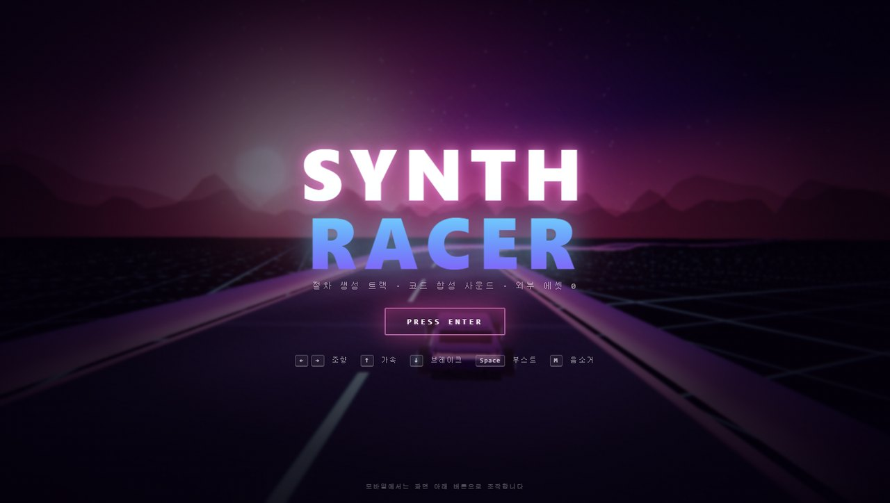
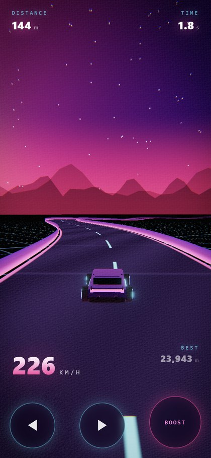

# SYNTH RACER

브라우저에서 도는 신스웨이브 아케이드 레이서입니다. 외부 이미지, 음원, 3D 모델 파일이 **하나도 없습니다**. 트랙, 차량, 하늘, 배경음악, 효과음까지 전부 런타임에 코드로 생성합니다.


| 타이틀 | 부스트 |
| --- | --- |
|  |  |



## 특징

- **절차 생성 트랙**: 푸리에 급수로 닫히는 폐곡선을 만들고, 호 길이 기준으로 균등 재샘플링해서 스트라이프와 물리 계산이 곡률에 영향받지 않게 했습니다.
- **전부 코드로 만든 3D**: 차량은 프리미티브 조합이고, 도로·레일·격자·태양·하늘은 커스텀 GLSL 셰이더입니다.
- **코드 합성 사운드**: Web Audio로 Am–F–C–G 4마디 신스웨이브 루프(킥·스네어·하이햇·베이스·아르페지오·패드)와 속도에 반응하는 엔진음을 만듭니다.
- **포스트프로세싱**: UnrealBloom에 색수차·비네트·필름 그레인·스캔라인을 더한 커스텀 패스를 얹었습니다.
- **아케이드 주행**: 조향, 원심력, 레일 충돌, 카메라 뱅킹, 속도에 따른 FOV 변화. 입력이 없으면 커브에서 자동으로 차선 중앙으로 돌아옵니다.
- **모바일 대응**: 터치 버튼, 세로 화면용 카메라 보정, 프레임이 떨어지면 자동으로 품질을 낮춥니다.
- **에셋 0개**: 배포물은 HTML과 JS, CSS 세 파일뿐이고 gzip 기준 약 150KB입니다.

## 조작

| 키 | 동작 |
| --- | --- |
| `←` `→` / `A` `D` | 조향 |
| `↑` / `W` | 가속(기본 자동) |
| `↓` / `S` | 브레이크 |
| `Space` | 부스트 |
| `Enter` | 시작 / 재개 |
| `P` `Esc` | 일시정지 |
| `R` | 다시 시작 |
| `M` | 음소거 |

모바일에서는 화면 아래 ◀ ▶ 와 BOOST 버튼을 씁니다.

## 실행

```bash
npm install
npm run dev       # http://127.0.0.1:5173
npm run build     # dist/ 에 정적 파일 생성
npm run preview   # 빌드 결과 미리보기 (http://127.0.0.1:4173)
```

## 배포 (GitHub Pages)

`.github/workflows/deploy.yml`이 `main` 브랜치에 푸시될 때 타입 검사, 빌드, Pages 배포를 수행합니다.

1. 저장소를 만들고 이 폴더를 푸시합니다.
2. 저장소 **Settings → Pages → Build and deployment → Source**를 **GitHub Actions**로 설정합니다.
3. 첫 워크플로가 끝나면 `https://<사용자>.github.io/<저장소>/`에서 열립니다.

`vite.config.ts`의 `base: './'` 덕분에 하위 경로에 배포해도 에셋 경로가 깨지지 않습니다. 빌드는 `build.mjs`가 `index.html`의 스크립트 경로를 상대 경로로 바꿔 줍니다.

## 구조

```text
src/
  main.ts     게임 루프, 상태 머신, 물리, 카메라, 품질 관리
  track.ts    폐곡선 트랙 생성과 호 길이 샘플링
  road.ts     도로·레일·격자 메시와 셰이더
  car.ts      차량 메시, 휠 회전, 부스트 화염
  sky.ts      하늘 그라데이션, 신스웨이브 태양, 별, 산 실루엣
  post.ts     블룸과 마무리 셰이더 패스
  audio.ts    코드 합성 BGM 시퀀서와 엔진음
  hud.ts      HUD 갱신
  input.ts    키보드와 터치 입력
build.mjs     esbuild 프로덕션 빌드
```

## 성능

RTX 2070 Super, 1424×805에서 60fps로 동작합니다. 평균 프레임이 35fps 아래로 떨어지면 픽셀 비율을 낮추고, 그다음 블룸을 끕니다.

## 디버그

- `?autostart=1`을 붙이면 타이틀과 카운트다운을 건너뛰고 바로 주행합니다.

## 빌드 노트

Vite 8과 7의 네이티브 번들러가 프로젝트 경로에 한글이 들어 있으면 빌드 중 `0xC0000409`로 크래시하는 현상을 확인했습니다. 그래서 프로덕션 빌드는 esbuild(`build.mjs`)로 처리하고, 개발 서버와 미리보기만 Vite를 씁니다. ASCII 경로에서는 `vite build`도 정상 동작합니다.

## 사용한 오픈소스

- [three.js](https://threejs.org) (MIT)
- TypeScript, Vite, esbuild

## 라이선스

코드는 이 저장소 소유자에게 있습니다. 외부 에셋을 사용하지 않았으므로 별도의 에셋 라이선스가 필요하지 않습니다.
